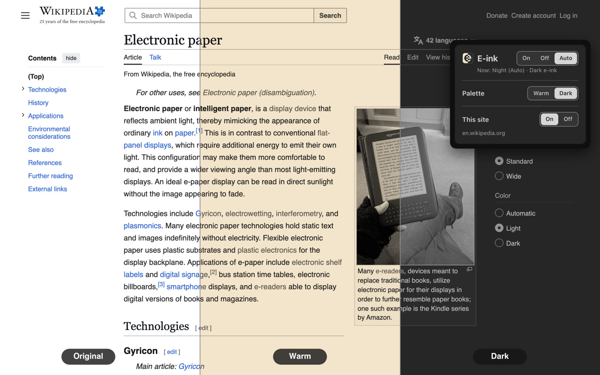

<p align="center"></p>

<h1 align="center">E-ink</h1>

<p align="center">A Chrome extension (Manifest V3) that gives every site an e-ink look:<br>grayscale, no accent colours, low glare.</p>

<p align="center"></p>

<p align="center"><sub>Wikipedia's <a href="https://en.wikipedia.org/wiki/Electronic_paper">Electronic paper</a> article as the site shows it, under Warm and under Dark (text CC BY-SA 4.0, photo CC0).</sub></p>

## What it does

Two palettes:

- **Warm**: a paper page (about `#f3e5cc`) with dark-gray text.
- **Dark**: a gray page (about `#262626`, not black) with soft light-gray text. Photos and avatars are inverted back, so they look normal, slightly dimmed.

A site with its own dark mode is shown in its light design first, and the palette applies to that, so dark-mode sites look like the rest.

The toolbar popup has three controls:

| Control | Choices | Default |
|---|---|---|
| **E-ink** (next to the name) | On (always), Off (never), or Auto (only while the Mac is in dark mode; sites as usual by day) | Auto |
| **Palette** | Warm or Dark, used whenever e-ink is active | Dark |
| **This site** | On or Off for the site in the current tab, shown by its host name (for example `github.com`) | On |

A line under the name says what applies now, for example "Now: Night (Auto) · Dark e-ink", or "Now: Night (Auto) · This site as usual" on a site switched off. Pages switch live, with no reload, when a setting changes and, in Auto, when macOS changes appearance (at sunset, with the Mac's appearance on Auto). Settings, including the sites switched off, are kept in Chrome sync storage.

## Install

The folder is the unpacked extension. It needs no dependencies or build step.

1. Open `chrome://extensions` and turn on Developer mode.
2. Click Load unpacked and choose this folder.
3. Reload open tabs. A page that was open before the extension loaded doesn't have it until it reloads.

E-ink needs access to every site. Its details page reads "Allow this extension to read and change all your data on websites you visit", with the choices On click, On specific sites and On all sites. E-ink expects On all sites; the other two limit it to the sites you allow. A Web Store install would warn "Read and change all your data on all websites".

**After changing any file**, press Reload on E-ink at `chrome://extensions`, then reload open tabs. A tab keeps running the old content script and CSS until it reloads, while the popup always loads fresh, so a new popup could write settings an old content script never reads. Keep Developer mode on: in a headless Chrome 156 test with it off, Chrome turned the reloaded extension off ("Turn on developer mode to use this extension").

Loading a copy from another folder makes a separate extension with its own settings. Switch the other copy off, or a page gets two filters.

## How it works

### The filter

`eink.css` puts one CSS `filter` on the top page's `<html>`: `grayscale` with a little `sepia` and `brightness` for Warm, or `invert(0.85) grayscale(1)` for Dark. It recolours nothing one by one, so it doesn't depend on any site's class names, and grayscale keeps each site's own contrast: bold unread rows, selected rows, focus rings and links stay distinct.

`content.js` runs on every page and frame. It reads the settings, checks `matchMedia("(prefers-color-scheme: dark)")` for Auto, and sets `data-eink="warm"` or `"dark"` on the top page's `<html>`, or removes it. The CSS applies only while that attribute is there. A page with no background of its own would show Chrome's white canvas, which the root filter doesn't reach, so it gets a white background while e-ink is on.

### Photos, frames and fullscreen

- **Photos**: where the page is inverted, `img`, `video` and `canvas` are inverted back, and so is any element drawn with an inline `background-image` `url()`. A `picture` wrapper is left alone; its `img` is filtered instead, preserving the image's containing block when it is absolutely positioned. X and other React Native for Web sites draw every photo, avatar and video poster as a background, with an invisible `` over it. That flip is `!important`, because the same inline style can set a filter of its own (X writes `filter: brightness(1)` on each one). Nothing inside an element that is already flipped back flips again. Gmail's own UI images stay inverted with the page: sprites on `cleardot.gif` and images under `/icons/mail/` (the wordmark).
- **Frames** get no filter of their own, because the top page's filter already covers them. A frame inside an inverted page gets `data-eink-frame`, which only flips its photos back. Frames go by the top page's site for This site, and by their own tab's top page for whether the site is dark anyway: the top page tells `bg.js` whenever its answer changes, `bg.js` passes it to every frame in that tab, and a frame asks its top page as it starts.
- **Fullscreen content** is drawn outside the root filter, so it gets a filter of its own and stays black and white, in the tones photos have on that page: gray with softened contrast under Dark and warm gray under Warm. Nothing inside it flips back. A fullscreen frame gets the page's filter, because its content still flips its photos back, and a frame inside a fullscreen player gets `invert(1)` while the page is inverted, which adds up to the same. When the whole page goes fullscreen (as on YouTube), the page filter simply stays. The filters are kept in `--eink-page` and `--eink-photo` on `<html>`.

### Light design first

`light.js` runs in the page's own JavaScript world at `document_start`, in every frame, so the site's scripts see what it changes. It makes the page see light mode in:

- `matchMedia` colour-scheme queries;
- the `@media` and `@import` rules of every stylesheet the page can read, and rules added later through `insertRule`, `replace` and `replaceSync` (CSS-in-JS);
- `media` attributes on `<link>`, `<style>` and `<picture>` sources, in new shadow roots too.

A dark query becomes `(width < 0px)` and a light one `(width >= 0px)`: valid queries that never and always match. `light.css` sets `color-scheme: light`, which decides `light-dark()` colours and form controls. `content.js` runs in Chrome's isolated world for extensions, so it still sees the Mac's real appearance, and Auto keeps working.

`bg.js`, the service worker, registers `light.js` and `light.css` only while E-ink is On or Auto, leaves out the sites switched off, and registers again whenever either changes. A page already open keeps what it loaded with until it reloads.

### Stylesheets from other sites

A stylesheet from another origin without CORS can't be read by the page. `light.js` then asks `content.js`, which asks `bg.js` to fetch its text, and a rewritten copy with the same `media` replaces it in place. Alternate and disabled stylesheets aren't copied.

Until the copy lands, the page shows whatever that stylesheet gives it, such as its dark theme, and the copy can take 100 ms or more (it is downloaded again, and the extension's worker may first have to wake). When it lands, `content.js` checks the page again in the same frame. A page that was dark until then and turns light, such as Brave Search in its Auto theme, is inverted at once instead of showing white under the dark-anyway filter.

The page can send that request too, so this is a trust boundary:

- `content.js` passes on only a stylesheet the document links to and can't read, at most 20 per page.
- `bg.js` fetches only `http(s)` URLs, without cookies, a referrer or redirects.
- It fetches nothing from this computer or its network unless the page is there too: loopback, private, shared and link-local addresses, `localhost`, `.local`, `.lan`, `.internal` and single-label names.
- It accepts only `text/css`, stops reading past 2 MB even without a `Content-Length`, and returns only CSS with colour-scheme rules.

That is the only network request E-ink makes.

### Sites that are dark anyway

A dark theme saved on the site itself would turn light under the plain filters. So `content.js` checks the page at DOMContentLoaded, at load and 2.5 s later for:

- a `<meta name="color-scheme">` of `dark`;
- a `dark` class on `<html>` or `<body>`;
- or else a vote over twelve points on a grid, each reading the first opaque background behind it. Colours come in whatever space Chrome computes them (`oklch()` for Tailwind 4, `oklab()` for `color-mix()`) and are converted through a 1 × 1 canvas. Computed styles ignore the filter, and `data-eink` is removed while it reads, so the white canvas doesn't count.

If most points are dark, it sets `data-site-dark`: Dark uses `grayscale(1) contrast(0.8)` to soften near-black backgrounds and bright text, and Warm inverts the page to paper first. A GitHub-style #0d1117 page renders as #272727 under Dark. The site's theme attributes and selected theme stylesheets are left alone: some sites only load the colours for their selected theme. PDFs are skipped, because Chrome's viewer is dark around a white page.

Single-page apps such as X change routes and switch their theme without reloading, so the page is checked again, at most every half second:

- after in-page navigation (`pushState`, back and forward);
- whenever any attribute on `<html>` or `<body>` changes: classes, style, or data attributes such as Bootstrap's `data-bs-theme` and GitHub's `data-color-mode`;
- when the page swaps in a new `<body>`, as Turbo does.

If the page strips `data-eink`, it is put back. The answer a page gets as it loads is kept in `chrome.storage.local` per site and appearance, and written only when it changes, so the next visit starts right. Later answers (a dark photo viewer over a light feed, say) decide only the page as it is. Each tab decides for itself, and its frames follow its top page live.

After an extension reload invalidates an old content script, its next callback disconnects its observer, removes its listeners and cancels its timers. Late API replies are ignored. It leaves the page's last appearance alone; refresh the page to load the new extension code.

### The popup

A small e-ink reader: a bezel around a screen in the chosen palette, in the system font. The name and icon label the On, Off and Auto switch, and the icon fades while sites show as usual. Each control is a `radiogroup` of native radio buttons styled as segments, so arrow keys move the choice, labels are clickable, and the focused segment shows a ring. Palette is disabled while E-ink is Off.

The popup asks the page in the current tab for its host name and whether its own dark theme is on. A page that doesn't answer is one Chrome keeps extensions off, or one that needs a reload; This site is disabled there, with that reason.

## Files

| File | What it is |
|---|---|
| `manifest.json` | The extension's manifest. |
| `content.js`, `eink.css` | The palettes, the dark-site check and the photo flip, on every page and frame. |
| `light.js`, `light.css` | The light design first, in the page's own world. |
| `bg.js` | The service worker: registers `light.js`, fetches stylesheets for it, and passes a top page's answer to its frames. |
| `popup.html`, `popup.css`, `popup.js` | The toolbar popup. |
| `icons/icon.svg` | The icon's source. Export the PNGs with `for s in 16 32 48 128; do rsvg-convert -w $s -h $s icons/icon.svg -o icons/icon-$s.png; done`. |
| `toggle.test.js`, `test/` | The checks below, and the pages they serve. |
| `docs/screenshot.jpg` | The screenshot at the top, taken in headless Chrome. |

## Pages Chrome blocks

Chrome doesn't let extensions change its own pages (`chrome://` settings, extensions and the new tab page), the Chrome Web Store, `view-source:` pages, top-level `data:` URLs or other extensions' pages, so those keep their own look. The PDF viewer is reached through the page around it. Local `file://` pages need "Allow access to file URLs" on the extension's details page (on by default for an unpacked extension), and Incognito windows need "Allow in Incognito".

## Known limits

- **A dark theme saved on the site itself** (an account setting such as YouTube's or Gmail's own dark theme, or a theme picked on the site and kept in its storage) stays selected. The dark-site check gives Dark as grayscale with softened contrast and Warm as paper. Setting the site's own appearance to "system" or "device" lets the light design come through. Filtered shades still depend on the site's original colours.
- **Switching off** (This site, or E-ink Off) removes the filter at once, but a page already open keeps its light design until it reloads, and then shows its own dark mode again.
- **Frames from another site inside a site switched off** still get the light design, because `light.js` goes by each frame's own host.
- **Shadow DOM**: photos inside shadow roots stay inverted, because page CSS doesn't reach into them, and styles in declarative shadow DOM (`<template shadowrootmode>`) aren't rewritten to light.
- **Server-chosen themes**: a site that picks its theme on the server from the `Sec-CH-Prefers-Color-Scheme` request header stays dark and falls back to the dark-site check.
- **Images and icons**: images set as CSS backgrounds from a stylesheet (not inline), emoji and inline SVG stay inverted with the page under Dark. Text inside an element whose inline background image is flipped back shows in that element's own colours. SVG icons in `` are flipped back like photos, so a dark icon can show dark on dark. Canvas-based apps such as online document editors are flipped back too, so their canvas may stay bright (inferred).
- **Copy-protected video** (Widevine, used by streaming sites) does take the filters: in headless Chrome on a Widevine test stream, and on screen on Disney+ (reported by the owner).
- **The white background** for pages without one also covers the area below a short page that sets a background only on `<body>`. Under Dark that strip is a few levels darker than the rest (`#262626` instead of `#2b2b2b` on the Gmail fixture).
- **The dark-site check** samples colours, so an unusual layout can still be read either way. The answer is remembered per site until a check disagrees.
- **The list of sites switched off** is one sync item, which Chrome limits to 8,192 bytes, roughly 300 host names. Past that, the popup says it could not save the setting.
- **Cost**: a full-page filter keeps the GPU busier while scrolling or playing video (in a headless test, Chrome's GPU process used about twice the CPU time, with no dropped frames). Rewriting stylesheets took 3–54 ms of main-thread time per page load in the same test, most on the largest sites. Each dark-site check took about 88 ms on a page of 46,000 elements, nearly all of it Chrome restyling the page while `data-eink` is lifted.

## Tests

```sh
node --test toggle.test.js
npm i --no-save playwright-core && node test/e2e.js
```

### Unit tests

`toggle.test.js` runs `content.js`, `light.js`, `bg.js` and `popup.js` against simulated Chrome APIs, appearance and pages. It covers:

- **Settings**: every combination of mode, palette and appearance; live appearance and setting changes; defaults; invalid settings; save and load failures; and the popup saving one choice at a time, without a failed older save undoing a newer one.
- **The dark-site check**: the grid (including a light page with a dark player at the centre, and colours in `oklch()`), meta and class signals, the PDF skip, the per-site cache, checking again after in-page navigation and page changes (throttled, and not remembered), and putting a stripped attribute back.
- **Tabs and frames**: each tab deciding for itself, frames following their own top page through `bg.js`, and the This site list.
- **Light design**: every form of the colour-scheme query and rewriting it twice, nested and imported rules, late rules and media attributes, and the cross-origin copy and its `media`.
- **Trust boundaries**: the relay's and the fetch's checks, the 2 MB cap on a body of unknown length, and local and private hosts.
- **Registration**: the sites left out of `light.js`, IPv6 and underscore hosts included.

### End-to-end test

`test/e2e.js` starts headless Google Chrome and loads this folder through the DevTools `Extensions.loadUnpacked` command (branded Chrome ignores `--load-extension`). `EXT=<folder>` loads another copy. The popup is opened as a tab, and a test-only script points it at the page under test. Screenshots of each state go to `test/screenshots/`.

On a Gmail-like inbox (`test/fixture.html`, served at a `mail.google.com` URL, plus a copy recoloured like Gmail's dark theme), it checks that:

- Auto follows `prefers-color-scheme` live;
- Gmail's text, link and row colours pass WCAG AA (4.5:1) under each palette, with no accent colour left;
- the popup's text passes 4.5:1, and its segment outlines and focus ring 3:1, in both palettes;
- arrow keys and label clicks in the popup reach Gmail live, and settings survive a reload;
- UI images stay inverted while photos flip back, and the dark-theme filters and popup note apply.

On small pages served at `sites.test`, in dark mode, it checks that:

- six ways of picking dark mode (`test/force.html`, with a stylesheet from another origin, `test/force-x.css`) all show the light design while Auto still turns on;
- a dark account theme with separately loaded light/dark tokens (`test/account-theme.html`) keeps its selected theme, contribution levels and links in both palettes, including site reassertion, body swaps and restored palette attributes;
- This site turns a page off and on live and keeps `light.js` off it, also on an IPv6 address and a host name with an underscore;
- `chrome://version` disables This site;
- a saved dark theme (`test/saved-dark.html`) falls back to grayscale only;
- pages coloured in `oklch()` and `oklab()` (`test/oklch.html`) are read as light or dark as they look;
- themes switched with data attributes, also on a `<body>` swapped in without a reload (`test/theme.html`), are checked again;
- a page whose dark theme comes from another origin's stylesheet, as Brave Search's Auto theme does (`test/auto-theme.html` and `test/auto-theme.css`), is inverted in the same frame the light copy lands, with that copy slowed down as when the extension's worker wakes;
- a page with no background (`test/plain.html`) is dark gray, not white;
- six ways of going fullscreen (`test/fullscreen.html` and the embedded player `test/embed.html`: a player, the video itself, a frame the page makes fullscreen, a player with a frame in it, an embed making its own player fullscreen, and the whole page) are black and white in both palettes, on a light page and on one that is dark anyway, never in colour or a negative; keep the tones the photo has in the page (within 6 levels); and leave the page as it was;
- a page built like X (`test/social.html`: photos drawn as inline backgrounds, an avatar inside a background banner, a photo viewer opened with `pushState` over a black backdrop, a dark theme switched on late, and a frame from another site) shows every photo in gray, never a negative, flips the frame's photo back only while the page around it is inverted, is checked again on each change, gets `data-eink` back if it strips it, and isn't rewritten while idle.

The fixtures approximate real sites. The 2026-10-20 check on real Gmail (light theme) is in the commit history, and the 2026-10-31 build was compared on GitHub, MDN, Next.js docs, YouTube and BBC in headless Chrome. These tests repeat none of that.

The e2e suite also reloads its isolated test extension with a page still open, then triggers appearance, navigation, DOM and stylesheet events. The invalidated script must report no uncaught errors or restore removed attributes.
